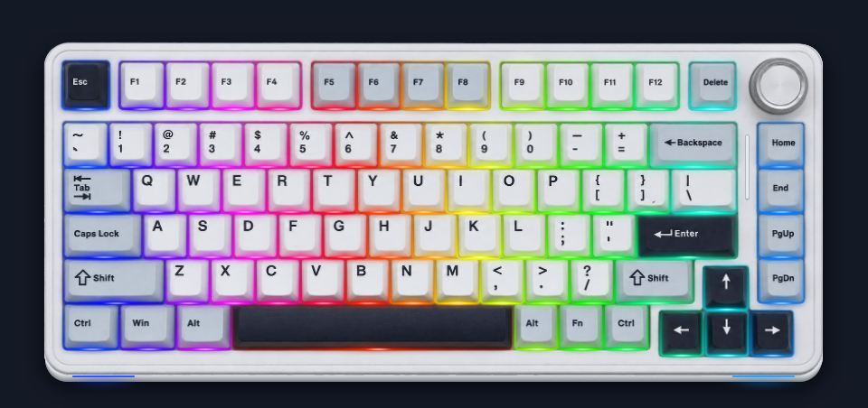

# AULA Control

[English](README.md) · **Español**

[](https://github.com/osakadesuka/Aula-Control/actions/workflows/windows.yml)
[](#requisitos)
[](VERSION)
[](#firma-y-smartscreen)

Aplicación Windows para iluminación, batería y gestos multimedia de la perilla de la **unidad EPOMAKER EA75 / AULA F75 comprobada en este proyecto**. Permite conexión USB y receptor 2.4 GHz, con interfaz en español e inglés y estilos Glass y Neumorfismo.

Proyecto comunitario independiente, sin afiliación ni respaldo de AULA o EPOMAKER. Otras variantes F75 pueden utilizar protocolos diferentes.



## Funciones

- 18 efectos caracterizados, color único o RGB arcoíris, brillo nativo y velocidad del efecto.
- Perfiles locales y memoria del último envío correcto, con restauración automática opcional al abrir o reconectar.
- Visualizador fotográfico del teclado con animaciones propias de cada efecto. La fase es aproximada y no lee los cambios hechos desde la perilla física.
- Actualización automática de batería cada 30 o 60 segundos mediante el receptor 2.4 GHz.
- Gestos opcionales: un clic reproduce/pausa, dos pasan a la siguiente pista y tres envían pista anterior. El giro conserva el volumen nativo.
- Funcionamiento en bandeja, inicio opcional con Windows y memoria de ventana y apariencia.

## Compatibilidad

| Conexión | Iluminación | Batería | Interfaz comprobada |
| --- | --- | --- | --- |
| USB | Compatible con la unidad probada | No disponible | EPOMAKER EA75, `0C45:8006`, interfaz 2. USB tiene prioridad cuando ambos canales están conectados. |
| Receptor 2.4 GHz | Compatible con la unidad probada | Porcentaje experimental | EA75 Dongle, `05AC:024F`, interfaz 3. |
| Bluetooth | Sin implementar | Sin implementar | Poder escribir o usar multimedia de forma nativa no demuestra control RGB desde esta aplicación. |

También se verifican producto, uso y descriptor de informes. Compartir VID/PID no basta. El catálogo completo de efectos se caracterizó físicamente por 2.4 GHz; las pruebas USB se describen en las notas de desarrollo.

## Requisitos

- Windows 10 2004 o posterior, **x64**.
- Controlador gráfico compatible con Vulkan.
- Teclado/receptor compatible con la identificación anterior.

El Setup incluye las bibliotecas necesarias de C++. Utiliza HID de Windows y no instala un controlador de kernel.

## Instalación

1. Cuando se publique la versión, abre **Releases** de este repositorio y descarga `AULA-Control-1.0.0-Setup-x64.exe` y su archivo `.sha256`.
2. Compara el SHA256 de la descarga con el indicado en la publicación.
3. Ejecuta el Setup. Instala para el usuario actual y crea **Inicio → AULA Control**. El acceso de escritorio es opcional.

La carpeta del programa es `%LOCALAPPDATA%\Programs\AULA Control`. Los perfiles, las preferencias y la memoria de iluminación se guardan por separado en `%LOCALAPPDATA%\AulaControl` y se conservan al actualizar o desinstalar.

Antes de actualizar o desinstalar, termina la aplicación mediante **Salir de AULA Control** en Preferencias o en el menú de la bandeja. La X puede ocultarla solamente. Una entrada existente de inicio con Windows se migra a la ruta instalada; una primera instalación no lo activa automáticamente.

## Firma y SmartScreen

**La versión 1.0.0 no tiene firma digital.** Windows puede mostrar un aviso de SmartScreen o de editor desconocido, y las políticas del equipo pueden impedir su ejecución. Descarga desde la publicación del proyecto y compara el hash. Un SHA256 coincidente comprueba que el archivo corresponde al publicado; no sustituye una firma digital confiable.

```powershell
Get-FileHash -Algorithm SHA256 .\AULA-Control-1.0.0-Setup-x64.exe
```

Consulta la [documentación de SmartScreen de Microsoft](https://learn.microsoft.com/windows/apps/package-and-deploy/smartscreen-reputation).

## Gestos multimedia de la perilla

Mantén pulsada la perilla unos 3–5 segundos para entrar en su modo multimedia nativo. Activa **Clics multimedia** en la aplicación para usar los gestos. Esta opción **sustituye globalmente Silencio de Windows**, también cuando procede de otros dispositivos, mientras AULA esté abierta. No guarda el texto que escribes. El reproductor decide si Pista anterior reinicia la canción o selecciona la precedente.

## Compilar y contribuir

- [Compilación, pruebas y empaquetado — English](docs/building.md)
- [Compilación, investigación y desarrollo — Español](docs/desarrollo.md)
- [Contributing / Cómo contribuir](CONTRIBUTING.md)
- [Informar de un error / Report a bug](https://github.com/osakadesuka/Aula-Control/issues/new/choose)

**Windows CI** compila Release, ejecuta las 13 pruebas actuales, genera el instalador sin firma y comprueba instalación, actualización y desinstalación. Guarda artefactos para revisarlos; no publica versiones ni cambia la visibilidad del repositorio. El indicador de un workflow privado solo es accesible a quienes tienen permiso.

## Licencias

La licencia principal del código todavía está pendiente de elección. Las etiquetas no implican GPL ni MIT. Las licencias de terceros están en [packaging/THIRD-PARTY-NOTICES.txt](packaging/THIRD-PARTY-NOTICES.txt) y se incluyen en el Setup.
