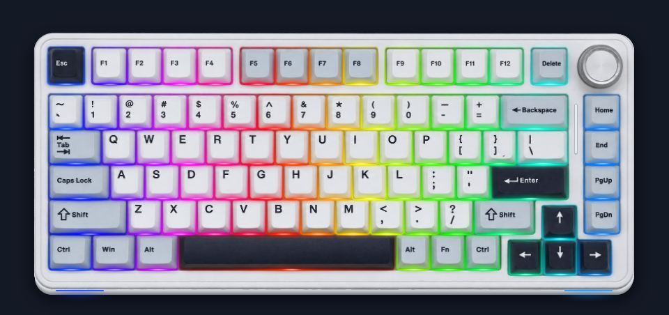

# AULA Control

**English** · [Español](README.es.md)

[](https://github.com/osakadesuka/Aula-Control/actions/workflows/windows.yml)
[](#requirements)
[](VERSION)
[](#signature-and-smartscreen)

Windows application for lighting, battery information and knob media gestures on the **EPOMAKER EA75 / AULA F75 unit verified by this project**. Supports USB and the 2.4 GHz receiver, with an English/Spanish interface and Glass or Neumorphic appearance.

Independent community project. Not affiliated with or endorsed by AULA or EPOMAKER. Other F75 variants may use different protocols.



## Features

- 18 characterized lighting effects, single color or rainbow RGB, native brightness and effect speed.
- Local profiles and memory of the last successfully sent settings, with optional automatic restoration on startup or reconnect.
- Photographic keyboard preview with effect-specific animations. Animation phase is approximate; it does not read changes made using the physical knob.
- Automatic battery polling every 30 or 60 seconds over the 2.4 GHz receiver.
- Optional knob gestures: one click for play/pause, two for next track and three for previous track. Rotation keeps native volume control.
- Tray operation, optional Windows startup, and remembered window and appearance settings.

## Compatibility

| Connection | Lighting | Battery | Verified interface |
| --- | --- | --- | --- |
| USB | Supported on the verified unit | Unavailable | EPOMAKER EA75, `0C45:8006`, interface 2. USB takes priority while both channels are connected. |
| 2.4 GHz receiver | Supported on the verified unit | Experimental percentage | EA75 Dongle, `05AC:024F`, interface 3. |
| Bluetooth | Not implemented | Not implemented | Native typing/media support does not imply RGB control through this app. |

Identification also checks the product, usage and report descriptor. Matching a VID/PID alone is not enough. The full effect catalog was physically characterized over 2.4 GHz; USB validation is described in the development notes.

## Requirements

- Windows 10 version 2004 or later, **x64**.
- A Vulkan-capable graphics driver.
- The compatible keyboard/receiver described above.

Setup includes the required C++ runtime libraries. It uses Windows HID support and does not install a kernel driver.

## Install

1. When the release is published, open this repository's **Releases** section and download `AULA-Control-1.0.0-Setup-x64.exe` and its `.sha256` file.
2. Compare the download's SHA256 with the release value.
3. Run Setup. It installs for the current user and creates **Start → AULA Control**. A desktop shortcut is optional.

The program directory is `%LOCALAPPDATA%\Programs\AULA Control`. Profiles, preferences and lighting memory are stored separately in `%LOCALAPPDATA%\AulaControl` and are preserved when updating or uninstalling.

Before updating or uninstalling, choose **Exit AULA Control** from Settings or the tray menu. The X may only hide the window. An existing Windows startup registration is migrated to the installed path; a first installation does not enable startup automatically.

## Signature and SmartScreen

**Version 1.0.0 is not digitally signed.** Windows may show a SmartScreen or unknown-publisher warning, and device policies may prevent execution. Download from the project's release and compare the checksum. A SHA256 match verifies correspondence with the published file; it does not replace a trusted digital signature.

```powershell
Get-FileHash -Algorithm SHA256 .\AULA-Control-1.0.0-Setup-x64.exe
```

See Microsoft's [SmartScreen documentation](https://learn.microsoft.com/windows/apps/package-and-deploy/smartscreen-reputation).

## Knob media gestures

Hold the knob for approximately 3–5 seconds to enter its native multimedia mode. Enable **Media clicks** in the app to use the gestures. This opt-in feature **globally replaces Windows Mute**, including events from other devices, while AULA is running. It does not record typed text. The media player decides whether Previous restarts the current track or selects the preceding one.

## Build and contribute

- [Build, tests and packaging — English](docs/building.md)
- [Compilación, investigación y desarrollo — Español](docs/desarrollo.md)
- [Contributing / Cómo contribuir](CONTRIBUTING.md)
- [Report a bug / Informar de un error](https://github.com/osakadesuka/Aula-Control/issues/new/choose)

**Windows CI** builds Release, runs the current 13-test suite, creates the unsigned installer and checks an installation/update/uninstall cycle. It uploads artifacts for inspection; it does not publish a release or change repository visibility. A private repository's workflow badge is only accessible to authorized viewers.

## Licenses

A project-wide source license has not been selected yet. No GPL or MIT license is implied by the badges. Third-party licenses are listed in [packaging/THIRD-PARTY-NOTICES.txt](packaging/THIRD-PARTY-NOTICES.txt) and included in Setup.
